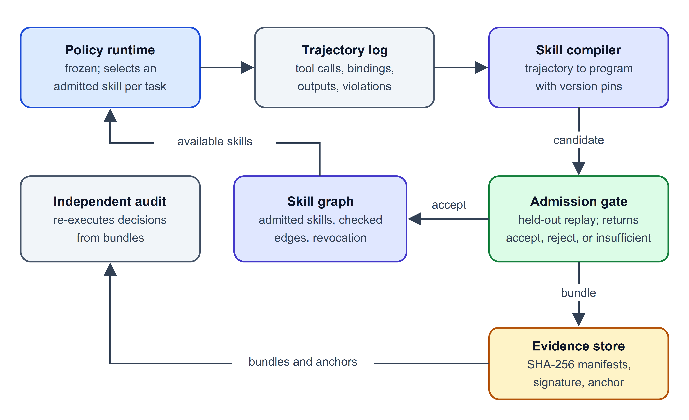
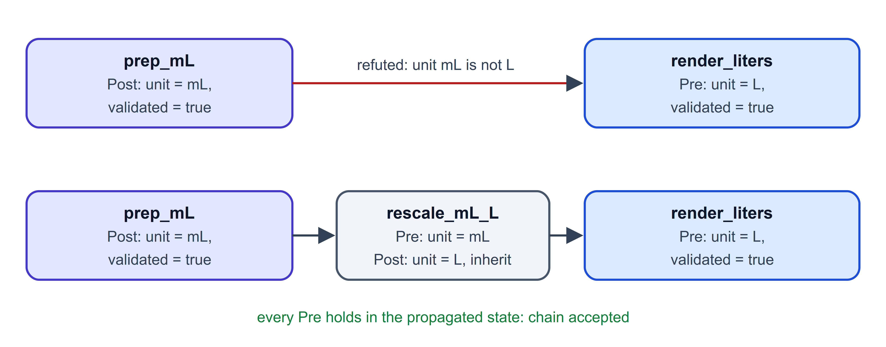
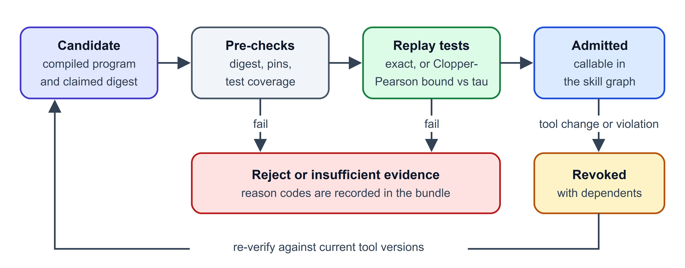

% title Audited Skill-Graph Self-Improvement: Evidence-Gated Admission of Agent Skills
% authors Jerry Huang, Yingjun Chen, Pin-Yu Chen, Ken Huang
% affiliations Kleiner Perkins · Georgia Tech · IBM · DistributedApps.ai

ABSTRACT: Agents that add reusable skills to a library while deployed can also add faulty skills, and later tasks then reuse those faults. Audited Skill-Graph Self-Improvement (ASG-SI) treats a skill library as a graph whose nodes enter only through an admission gate: a candidate program compiled from a successful trajectory is replayed on held-out tests with required boundary coverage, checked against declared interface contracts, and admitted, rejected, or held for insufficient evidence. Every decision is written to a hashed, optionally signed evidence bundle from which an independent audit re-executes the decision. We evaluate the gate in seven experiments. On candidates written by three frozen local language models (a 4B model, a 35B mixture-of-experts model, and a 748B DeepSeek model), {{ABSTRACT_LLM}} With stochastic, partially observable tools, exact replay accepted an adequate skill in only 67.4 % of trials, while a sequential Clopper–Pearson gate with a reliability threshold fixed in advance accepted every adequate skill and no inadequate one across 500 trials per candidate. Contract checks blocked every incompatible chain of two to five skills without tool calls, at the cost of also blocking 6 chains whose unit errors cancelled. A silent tool upgrade reduced unpinned success to 60 %, and version pins with revocation and re-verification kept it at 100 %. The audit detected each evidence attack only when the matching defence was present. The policy is frozen throughout; the paper makes no claim about reward-driven learning, and all environments are small and synthetic.

## 1 Introduction

Language-model agents increasingly keep what works. Voyager stores successful programs as callable skills [@wang2023voyager]; reinforcement-learning formulations add skill generation and reuse to the training objective [@wang2025skilllibrary]; and agentic reinforcement learning more broadly treats tool use, memory, and self-improvement as parts of one interactive policy [@zhang2025landscape]. A library that grows during deployment is useful because later tasks reuse earlier work. The same property makes it a liability: a skill that passed once on a narrow example and is wrong in general is reused on every later task that selects it.

This paper studies one control point in such systems: the decision to admit a skill into the library. The question is whether verification before admission keeps faulty skills out, under which conditions it fails, and what it costs. We call the overall design Audited Skill-Graph Self-Improvement (ASG-SI). The unit of improvement is an admitted skill with an explicit program, pinned tool versions, a declared interface, and an evidence bundle. An admission gate separate from the policy replays each candidate on held-out tests before it becomes callable, and an independent audit can re-execute every admission decision from the stored evidence.

Two uses of verification are combined. Verifiable-reward work uses deterministic evaluators as training signals [@wen2025rlvr; @wu2025hidden]. ASG-SI uses verification to gate which capabilities exist at all, and it records the evidence so that a third party can reproduce the decision. Prior skill libraries also verify candidates, usually with the same model that wrote them [@wang2023voyager; @shinn2023reflexion]. Section 6.2 compares the two forms of verification on naturally generated candidates.

The contributions are the following.

- An admission gate with three outcomes (accept, reject, insufficient evidence), coverage requirements, version pins, interface checks on composed chains, and a sequential statistical variant for stochastic tools (Section 4).
- An evidence format with full SHA-256 manifests, optional HMAC signatures, and an independent audit that re-executes decisions, together with a measured matrix of which defence detects which attack (Sections 4.6 and 6.6).
- Seven experiments: a controlled fault benchmark, candidates from three frozen language models compared with LLM self-verification and SmartSnap-style evidence verification, stochastic tools, composition chains up to length five, selection in libraries of up to 200 skills, evidence tampering and poisoning, and retention under a tool upgrade (Section 6).
- A public implementation, raw evidence, and an audit command that regenerates every reported decision (Appendix A).

Section 2 reviews related work, Section 3 states the setting and threat model, Section 4 defines the method, Section 5 describes the experimental setup, Section 6 reports results, and Section 7 discusses limitations.

## 2 Related Work

Related work falls into five groups: skill libraries, self-verification, verifiable rewards, tool-use learning, and software supply-chain integrity. Table 1 compares the systems closest to ASG-SI on the properties that matter for admission.

**Skill libraries and self-improving agents.** Voyager builds a code skill library in Minecraft and adds a program after an LLM critic judges the task complete [@wang2023voyager]. Wang et al. integrate skill generation and use into reinforcement-learning training, adding skills after successful use [@wang2025skilllibrary]. Skill-it orders training data by skills rather than storing callable programs [@chen2023skillit]. SuperIntelliAgent pairs a trainable learner with a frozen LLM verifier that labels the learner's outputs for continual DPO training [@lin2025superintelliagent]. ASG-SI keeps the library idea but moves the admission decision to held-out replay by a separate process and records the evidence.

**Self-verification and evidence-seeking agents.** Reflexion and CRITIC use model feedback, optionally with tools, to revise outputs [@shinn2023reflexion; @gou2023critic]. Huang et al. report that models often fail to correct their own reasoning without external feedback [@huang2023cannot]. SmartSnap trains a GUI agent to collect snapshot evidence of task completion for an LLM verifier [@cai2025smartsnap]. SmartSnap and SuperIntelliAgent have public code, but they target Android GUI control and diffusion-model training respectively; we did not run them on our benchmark. Instead, Section 6.2 re-implements their admission rule (an LLM verifier judging evidence, with the evidence curated by the proposer in the SmartSnap variant) inside the same harness.

**Verifiable rewards and measurement.** Outcome verifiers and process verifiers improve reasoning training [@cobbe2021verifiers; @lightman2023verify], and reinforcement learning with verifiable rewards improves reasoning in base models [@wen2025rlvr]. Wu et al. document measurement gaps, including contamination and missing parity controls, that can overstate such gains [@wu2025hidden]. ASG-SI applies these concerns to admission: separate splits, a fixed metric, and evidence from which every number is regenerated.

**Tool use, memory, and agent infrastructure.** Toolformer and ToolRL study how models learn tool calls and how reward structure affects tool learning [@schick2023toolformer; @qian2025toolrl]. Progressive reward shaping stages structural and outcome rewards [@su2025progressive]. MEM1 and Memory-R1 train memory operations with reinforcement learning [@zhou2025mem1; @yan2025memoryr1]. AgentRL and Agent Lightning decouple rollout and training [@zhang2025agentrl; @luo2025lightning]; the ASG-SI compiler and gate can run as separate services in such pipelines. Experience synthesis generates training interactions from a learned environment model [@chen2025experience]. Continual and constraint benchmarks measure forgetting and outcome-driven violations [@joshi2025swebenchcl; @li2025constraint].

**Admission control and supply-chain integrity.** Proof-carrying code requires a program to ship with a proof that the host checks before execution [@necula1997pcc]. The simplex architecture keeps a verified controller as a fallback for an unverified one [@sha2001simplicity]. in-toto records signed metadata for each step of a software supply chain so that a consumer can verify the whole chain [@torresarias2019intoto]. ASG-SI applies the same pattern, check before admission and keep verifiable provenance, to skills produced by an agent, with empirical replay instead of proofs.

Table 1 contrasts the closest systems. Each entry describes the published method; the table does not rank overall quality.

| System | What enters the library or model | Verifier | Held-out tests | Evidence for third-party replay | Revocation on change |
|---|---|---|---|---|---|
| Voyager | code skill | same LLM (critic) | no | no | no |
| Wang et al. (2025) | skill | task success | no | no | no |
| SmartSnap | trajectory reward | LLM judging agent-chosen evidence | no | snapshots | no |
| SuperIntelliAgent | learner update | frozen LLM | no | no | no |
| ASG-SI | compiled skill program | separate replay process | yes, with coverage | hashed, signed bundles | yes, transitive |
Widths: 1.2,1.25,1.3,0.85,1.0,0.8
Table: Table 1: Admission properties of systems that add skills or updates after verification

## 3 Setting, Threat Model, and Scope

An agent solves a stream of tasks with tools. A task has a public observation (its inputs) and private evaluator data (the expected output), and the policy never receives the private part. Tools have declared contracts and versions. A successful trajectory can be compiled into a program and submitted as a candidate skill. Admitted skills become callable for later tasks.

**Determinism assumption.** Exact replay requires deterministic tools, or tools whose randomness is seeded and recorded. Sections 4.3 and 6.3 relax this with a statistical gate for tools that are stochastic and only partly observable.

**Adversary.** We consider three tiers. An external attacker controls task inputs and tool outputs. A supply-chain attacker can modify a skill artifact, the verifier, or stored evidence. The self-improving agent itself can propose skills that pass tests while violating requirements outside the tested distribution. The security goals are auditability (each decision can be re-executed from evidence), integrity of admission (only candidates that pass held-out checks become callable), controlled composition (chains are admitted only when declared interfaces agree), and measurement reliability (reported numbers are regenerated from raw records).

> **Scope of claims.** The experiments support claims about admission: which candidates a gate admits, what that does to downstream success, what it costs, and which attacks an audit detects. No policy is trained; every model is frozen. All environments are small and synthetic. The guarded-fallback edge type and learned reward schedule described in earlier drafts are design proposals and are not evaluated.

## 4 Method

ASG-SI has five components: a frozen policy runtime, a trajectory log, a skill compiler, an admission gate, and a skill graph with an evidence store and an independent audit. Figure 1 shows how they connect. Candidates move from the compiler to the gate; accepted skills enter the graph and become available to the policy; every decision produces an evidence bundle that the audit can re-execute.



\pagebreak
### 4.1 Definitions

Table 2 lists the notation used in the rest of the paper.

| Symbol | Meaning |
|---|---|
| x, y* | public task inputs and private expected output |
| T, v(T) | tool and its version string |
| C(T) = (args, out, units) | declared tool contract: argument types, output type, input and output units |
| P = (s_1 … s_k, o, pins) | program: ordered steps with bindings to inputs, earlier outputs, or literals; output step o; exact version pin for every tool |
| id(P) | SHA-256 of the canonical JSON of P |
| I(P) = (Pre, Post) | interface: partial assignments over declared tags (unit, validated); Post values may inherit |
| G = (V, E) | skill graph: admitted programs and checked composition edges |
| D_promo, D_eval, D_stress | disjoint promotion, evaluation, and stress splits; disjointness is checked on task content |
| B = (k, b) | coverage requirement: at least k unique cases spanning boundary classes b |
| tau, alpha | minimum acceptable success rate and one-sided error for the statistical gate |
| E | evidence bundle: candidate, tests, configuration, decision, manifest, optional signature |
Widths: 1.6,4.8
Table: Table 2: Notation

A **skill** is a program P with its identity id(P) and interface I(P). An **edge** (A, B) is composition-ok when every tag required by Pre(B) holds in the state produced by propagating Post(A); Section 4.4 gives the procedure. An **admission decision** is one of ACCEPT, REJECT, or INSUFFICIENT_EVIDENCE, with reason codes.

### 4.2 Skill compilation

The compiler records each tool call of a successful trajectory with the binding of every argument and converts the trajectory into a program. Algorithm 1 gives the procedure. Only trajectories that succeed on their discovery example are compiled, so every candidate in this paper has at least one success.

```algorithm Algorithm 1: Compile a successful trajectory into a program
input: trajectory events e_1..e_k (tool, bindings, tool version), task inputs x, success flag
if not success or any event lacks a tool or bindings: return none
steps <- [(id_i, tool_i, bindings_i) for each event e_i]   # input key, earlier step, or literal
pins  <- {tool_i: version_i}                               # exact versions observed
P     <- (steps, output = id_k, pins, input_keys = keys(x))
return P, id(P) = SHA-256(canonical_json(P))
```

The compiler does not segment long trajectories into reusable sub-skills and does not infer interfaces from data. Interfaces come from the declared tool contracts.

### 4.3 Admission gate

The gate receives a candidate, its claimed digest, and the promotion split. Algorithm 2 shows the exact-replay gate. The pre-checks reject artifacts whose digest does not match, programs with missing or stale pins, and duplicated test content; insufficient coverage returns INSUFFICIENT_EVIDENCE rather than ACCEPT. Each test passes only if the output matches the reference and no constraint was violated.

```algorithm Algorithm 2: Exact-replay admission gate
input: candidate (P, claimed digest), promotion cases D, coverage B = (k, b), tool registry R
if claimed digest != id(P): return REJECT("artifact_digest_mismatch")
if tools(P) != keys(pins(P)) or any R.version(t) != pins(P)[t]: return REJECT("pin")
cases <- relevant cases of D, at most max_cases
if |unique(cases)| < k or b not subset of boundaries(cases): return INSUFFICIENT_EVIDENCE
for c in cases:                                       # in a separate worker process
    r <- execute(P, c.inputs, R, enforce_pins=True)
    record r (events, outputs, violations) and reward components
    if r.error or r.output != c.expected or r.violations: return REJECT("replay_check_failed")
return ACCEPT
```

For tools whose outputs vary from run to run, exact replay is the wrong test: an adequate skill can fail one execution and an inadequate skill can pass all of them by chance. The statistical gate in Algorithm 3 fixes a minimum acceptable success rate tau before any data are seen and uses one-sided Clopper–Pearson bounds [@clopper1934]. Every execution is seeded, and the seeds are recorded, so the audit can replay the stochastic executions exactly.

```algorithm Algorithm 3: Sequential statistical gate for stochastic tools
input: program P, promotion cases D, tau = 0.90, alpha = 0.05, budgets (60, 240)
successes, n <- 0, 0
for budget in (60, 240):
    while n < budget: run P on D[n mod |D|] with a fresh recorded seed; update successes, n
    if lower_CP(successes, n, alpha) >= tau: return ACCEPT
    if upper_CP(successes, n, alpha) <  tau: return REJECT
return REJECT("inconclusive at maximum budget")
```

### 4.4 Composition checking

A composed skill calls admitted skills in sequence. The checker propagates interface tags left to right: the state starts empty, each skill's Pre must hold in the current state, and the state is then replaced by the skill's Post, with inherited tags copied from the incoming state. The first failing edge is reported with the tag, the required value, and the value found. Figure 2 gives an example in which a milliliter output feeds a renderer that requires liters, and the same chain with a rescaling skill inserted.



The check refutes only declared incompatibilities. It does not prove correctness for properties that no contract declares, and it blocks chains whose declared tags disagree even when their numeric errors cancel. Section 6.4 measures both effects.

### 4.5 Library lifecycle and selection

The graph stores admitted identities, their dependencies, and checked edges. Revoking a skill revokes every skill that depends on it. When the tool registry changes a version, every skill pinned to the old version is revoked; candidates are then re-pinned and re-verified against the current registry, and only those that pass return. Figure 3 shows the lifecycle from candidate to admission, rejection, revocation, and re-verification.



When several admitted skills apply to a task, the policy in Sections 6.1 and 6.2 selects uniformly at random among them, with a recorded seed, and abstains when none applies. Section 6.5 compares this rule with cost-greedy selection, ranking by admission evidence, and an upper-confidence-bound rule that learns from runtime-observable outcomes.

### 4.6 Evidence and audit

Each decision writes a bundle with four artifacts (candidate, test inputs and labels, gate configuration, decision with every execution trace and reward component) and a manifest. The manifest records the SHA-256 and byte length of each artifact, the Python version, the tool registry with versions and contracts, and the SHA-256 of every source file. Three optional controls strengthen the bundle: an external anchor (the manifest digest stored where the agent cannot write), an HMAC-SHA256 signature with a key held outside the run directory, and the independent audit, which checks the recorded environment against the auditor's code and re-executes the decision. The audit reports REPRODUCED only if the re-executed decision, traces, and rewards are byte-identical after canonical serialization.

### 4.7 Rewards

The decomposed reward of earlier drafts (tool validity, outcome, reuse, composition, memory) is computed and stored for every execution so that alternative weightings can be evaluated after the fact. All results in this paper use a fixed metric: success means a correct output with no constraint violation, with every other weight set to zero. Appendix C gives the proposed phase schedule as a design for future policy training; no reported result depends on it.

## 5 Experimental Setup

**Task.** A volume-report workflow: read records, validate fields (drop records whose valid flag is false), convert milliliters and liters to liters, sum, and write the report to the allowed destination. Ground truth comes from an independent Decimal reference implementation. Each split cycles through five boundary classes: ordinary, mixed units, invalid records, negative values, and empty input. Splits are disjoint on task content.

**Seeds and statistics.** Five run seeds (7, 42, 123, 456, 789) derive separate random streams for splits, candidate order, and selection. We report means with 95 % percentile bootstrap intervals over seeds where intervals have nonzero width; the statistical unit is the run seed. We make no significance claims, and intervals are conditional on the candidate pools used.

**Models.** Three frozen local models served through OpenAI-compatible endpoints: qwen3.5-4b (4-bit) and clover-35b-a3b, a 35B mixture-of-experts model, both on an Apple M4 Pro Mac mini with 64 GB memory, and a DeepSeek model with 748 billion parameters in Q8_0 GGUF format on an NVIDIA DGX Spark through llama.cpp. Every request and response is cached by the SHA-256 of the request, so the language-model experiments can be re-run offline from the recorded responses.

**Admission methods.** First success admits any candidate whose discovery example succeeded. LLM self-verification shows the same model the program, the specification, and one execution and asks for ACCEPT or REJECT. Evidence verification follows SmartSnap: the proposing model selects three test inputs, the harness executes the program on them, and the model judges the outputs. In-process checking and independent replay run Algorithm 2 in the same process or in a separate worker. Replay with composition checks adds the interface check of Section 4.4.

## 6 Results

### 6.1 Controlled fault benchmark

The first experiment uses a frozen pool of 10 candidates per run: three valid programs compiled from trajectories and seven controlled faults (memorized constant, incorrect binding, unit mismatch, prohibited write destination, modified artifact, stale tool pin, skipped validation). Every candidate succeeds on its discovery example; the unit mismatch succeeds only because its example is empty. Table 3 reports admission outcomes and downstream success.

{{TABLE_MAIN}}

Gating removed all 35 faulty admissions per method across the five runs and raised evaluation success from 45.3 % to 100 % on this benchmark, at 570 verification tool calls per run against 48. Composition checks reduced verification to 495 calls by refuting the unit-mismatch candidate before execution. In-process checking and independent replay returned identical decisions, as expected for pure functions under identical checks; the separate worker added {{WORKER_OVERHEAD}} of verification time per run on our Windows host and showed no accuracy benefit.

### 6.2 Candidates written by frozen language models

The second experiment replaces constructed faults with candidates written by models. Each model received the tool documentation, a task specification, and one example, under six conditions: documented or signature-only tools, crossed with a full specification, a terse request, or an example-only request. The registry includes one plausible shortcut tool, sum_values, which adds raw values without unit conversion or validity filtering and is documented truthfully. Table 4 summarizes generation.

{{TABLE_LLM_GEN}}

{{TEXT_LLM_GEN}}

Table 5 reports admission outcomes on the unique compiled candidates of each model. Validity labels come from hidden adjudication on the union of evaluation and stress cases for all five seeds, never from an admission method.

{{TABLE_LLM_ADMIT}}

{{TEXT_LLM_ADMIT}}

### 6.3 Stochastic and partially observable tools

The third experiment replaces the reader with read_records_noisy, which returns each record independently with probability 0.9, so a single call observes part of the input. Candidates reconcile one, two, or three independent reads; a fourth candidate reconciles three reads but ignores units. True success rates are estimated from 20,000 seeded executions on 200 evaluation tasks. Each gate runs 500 times per candidate with fresh promotion cases and seeds. Table 6 reports acceptance rates against the requirement tau = 0.90.

{{TABLE_STOCH}}

Exact single replay accepted the two-read skill, which meets the requirement, in 67.4 % of trials, and requiring all of four replays reduced that to 16.0 %; even the three-read skill was rejected in 17.6 % of trials under the four-replay rule. The statistical gate accepted both adequate skills in every trial and rejected both inadequate skills in every trial, using 150 executions on average for the two-read skill and 63 for the three-read skill.

### 6.4 Composition at depth

The fourth experiment composes chains of two to five admitted primitives over two declared tags: unit (liters, milliliters, centiliters) and validated. Each chain is a preparation skill, zero to three rescaling skills, and a renderer that requires validated liters. All primitives pass their own fixture tests, and no chain is tested before the final evaluation. Compatible and incompatible chains are sampled in equal numbers where enough exist. Table 7 reports the flat library, end-to-end replay on five tasks, and the interface check.

{{TABLE_DEPTH}}

Every incompatible chain produced some correct outputs, so per-task output checks on a few examples can pass an incompatible chain. End-to-end replay on five boundary-covering tasks admitted 6 incompatible chains, all of them functionally correct because their unit errors cancelled, and caught every chain that produced a wrong total, at 10 to 25 tool calls per chain. The interface check admitted no incompatible chain and rejected no compatible chain without any tool calls; it also blocked the 6 chains whose errors cancelled, which replay would have admitted.

### 6.5 Selection in larger libraries

The fifth experiment builds libraries of 10, 50, and 200 skills, 40 % valid variants with zero to three redundant steps and 60 % faulty variants from six fault templates, and evaluates 200 tasks per seed. Table 8 reports success and cost for four selection rules with and without the gate.

{{TABLE_SEL}}

Without the gate, uniform selection reached 51 % to 56 % success, and cost-greedy selection reached 0 % because the cheapest program is the memorized constant. The runtime-feedback rule, which observes only errors and constraint violations, fell to 32 % at 200 skills because wrong totals produce no runtime signal. Ranking by admission-test results reached 100 % even without the gate, because it uses the same verification evidence. With the gate, every rule reached 100 %, and cost-greedy selection also minimized tool calls.

### 6.6 Evidence attacks and poisoning

The sixth experiment applies six attacks to the bundle of a faulty candidate that the honest gate rejected and runs each defence layer on its own. Table 9 reports which layer detected each attack.

{{TABLE_TAMPER}}

Per-artifact hashes detect edits but not an attacker who also recomputes the manifest. An external anchor or signature detects that attacker. A compromised verifier that writes a forged decision at decision time produces a correctly anchored and signed bundle; only the audit's re-execution of the decision detects it, and a verifier that records its own modified source is detected by the environment check.

The poisoning case is a skill that writes to the literal destination report. It passes every promotion case because all of them use that destination. Across five seeds the standard gate admitted it, and deployment on 200 tasks with 20 % alternate destinations produced {{POISON_VIOL}} violations without monitoring. Adding an alternate-destination boundary class to the coverage requirement caused the gate to reject it in every seed. A runtime monitor that revokes a skill after its first violation limited deployment to one violation per seed.

### 6.7 Retention under a tool upgrade

The seventh experiment runs ten checkpoints of 30 tasks. Before checkpoint 4 the provider upgrades validate_fields to version 2.0.0, which keeps records whose valid flag is false, and publishes a filter_valid tool. Table 10 reports success before and after the change.

{{TABLE_RET}}

Unpinned skills continued to run and produced wrong totals on every task that contained an invalid record, and no error was raised. Version pins turned the change into errors on every task. With the lifecycle, the version change revoked the stale skill, re-verification rejected the stale program re-pinned to version 2.0.0, and admitted an adapted program that calls filter_valid, so success stayed at 100 %.

## 7 Discussion and Limitations

**What the results support.** Replay with coverage requirements excluded every controlled fault class and every faulty model-written candidate in our pools, at roughly ten times the verification cost of first-success admission. Same-model verification was a weaker filter on the same candidates (Section 6.2). Exact replay is the wrong test for stochastic tools, and a statistical gate with a threshold fixed in advance separated adequate from inadequate skills in our setting. Interface checks are a cheap pre-filter that is sound for declared tags and conservative otherwise. Evidence integrity requires layers: hashes, an external anchor or signature, and re-execution each detect a different attack.

**Limitations.** The environments are small and synthetic, and the model-written faults are dominated by one shortcut that the registry made available. Natural fault rates depend on prompts and documentation and do not transfer to other tasks. Coverage requirements only test what the boundary classes describe; the poisoning case passed the standard gate. The separate verifier worker shares the operating-system identity of the policy and is not an adversarial sandbox; signatures assume the key is held outside the agent's reach. No policy is trained, so the paper makes no claim about reward-driven learning, utilization drift under learning, or the reward schedule in Appendix C. SmartSnap and SuperIntelliAgent were not run end to end; we re-implemented their admission rule. Evidence bundles can contain sensitive data and need access control and retention rules in deployment.

**Next steps.** Evaluate the gate on an established interactive benchmark such as ALFWorld [@shridhar2021alfworld] with model-generated candidates, train a policy against the stored reward components, and enforce the policy, verifier, and evidence boundary at the operating-system level.

## 8 Conclusion

ASG-SI makes the admission of a skill an explicit, recorded decision. Across seven experiments, held-out replay with coverage and interface checks kept faulty skills out of libraries in which first-success admission and same-model verification admitted them or rejected valid skills, a statistical gate handled stochastic tools, and layered evidence controls detected each simulated attack. The results are limited to small synthetic environments and frozen models, and they are reproducible from the published evidence.

## References

{{REFERENCES}}

## Appendix A: Reproducibility

The implementation, tests, and evidence are at https://github.com/kenhuangus/ASG-SI on branch review-response; {{COMMIT_NOTE}} The commands below regenerate every table from a clean checkout; the language-model experiments replay from the recorded response cache without access to the models.

```
python -m unittest discover -s tests
python -m experiments.run --config configs/smoke.json --output runs/main
python -m experiments.report runs/main
python -m experiments.audit runs/main
python -m experiments.llm_candidates --model clover --output runs/llm --n-per-spec 10 --offline
python -m experiments.stochastic --output runs/review/stochastic.json --trials 500
python -m experiments.composition_depth --output runs/review/composition_depth.json
python -m experiments.selection --output runs/review/selection.json
python -m experiments.tamper --output runs/review/tamper.json
python -m experiments.retention --output runs/review/retention.json
```

## Appendix B: Prompts for the language-model experiments

Each generation request contains a system message ("You write small tool-calling programs. Reply with a single JSON object and nothing else."), the tool documentation (full descriptions, or signatures only), the program format with binding rules, one of the three task statements below, and the discovery example with its expected output. Requests use temperature 0.8 and at most 4,096 output tokens; verification requests use temperature 0. The full prompt text is in experiments/llm_candidates.py, and every request and response is stored in the response cache.

- Full: "Write a reusable program for this task. Output the total volume, in liters, of all records whose valid field is true. Records can be in liters (L) or milliliters (mL). Write the report to the task's destination; writing anywhere other than allowed_destination is prohibited. The program must work for any input of this task, not only the example."
- Terse: "Write a program that totals the record volumes and writes the report."
- Example only: "Write a program that turns the example input into the example output."
- Self-verification: the full task statement, the candidate program, its execution on the discovery example, and the question "Will this program produce the correct report, without prohibited writes, for every valid input of this task?"
- Evidence verification: the proposing model first selects three task inputs that "would best reveal whether this program is correct"; the harness executes the program on them; the model then receives the program, the inputs, and the actual outputs and returns ACCEPT or REJECT.

\pagebreak
## Appendix C: Proposed reward schedule (design only)

The weights below are a proposal for future policy training and are not used by any result in this paper. Table 11 lists them by phase.

| Phase | Iterations | tool | outcome | reuse | compose | memory |
|---|---|---|---|---|---|---|
| structural | 1–2 | 0.5 | 0.3 | 0.1 | 0.0 | 0.1 |
| correctness | 3–4 | 0.2 | 0.4 | 0.2 | 0.1 | 0.1 |
| efficiency | 5–6 | 0.1 | 0.3 | 0.2 | 0.3 | 0.1 |
Table: Table 11: Proposed phase-dependent reward weights (not evaluated)
